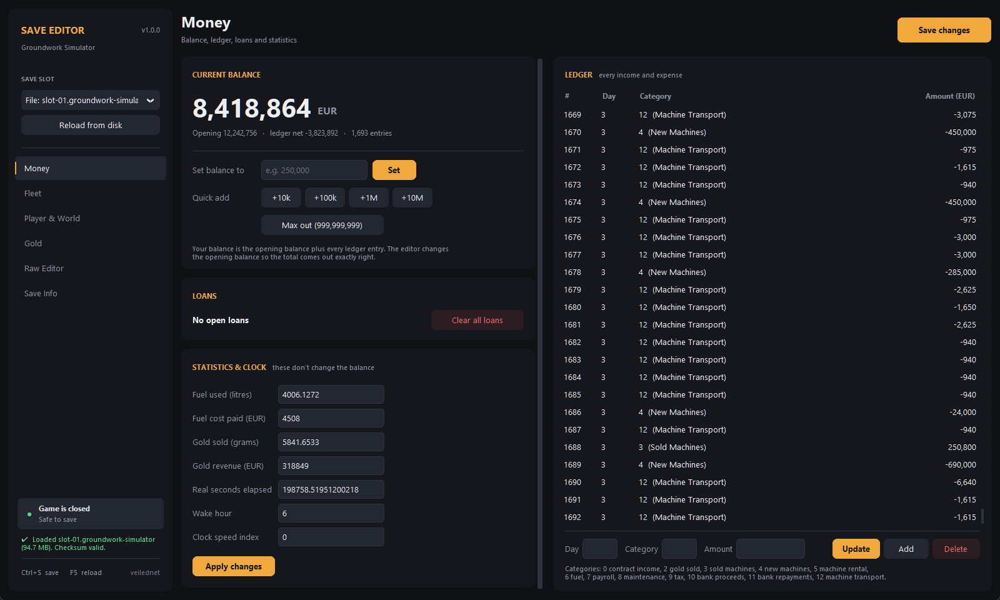
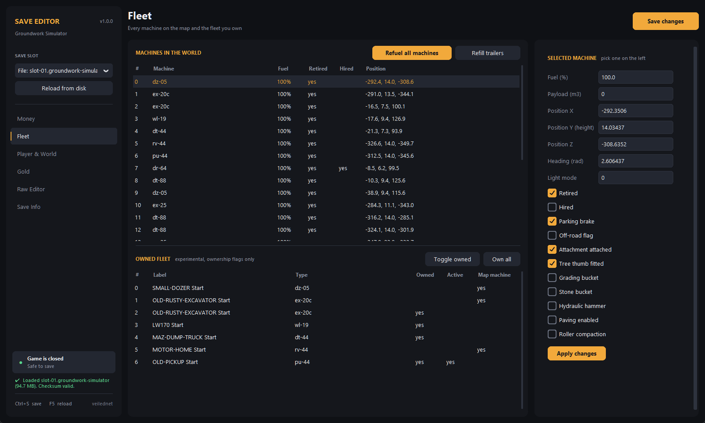
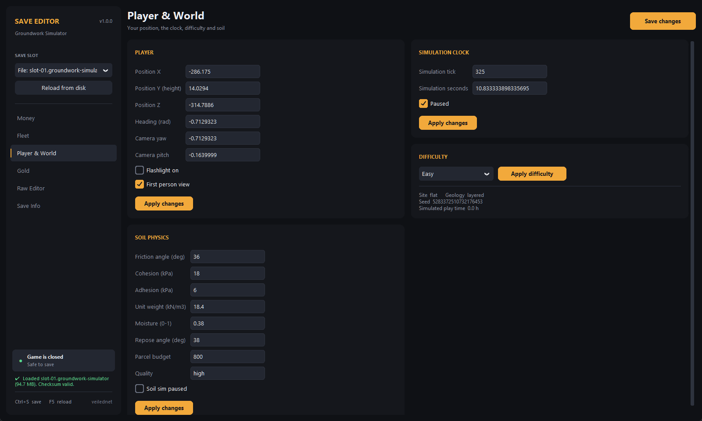

<p align="center"></p>

# Save Editor for Groundwork Simulator

Change your money, refuel your whole fleet, move your player, change the difficulty, or edit anything else in your save.

It's one program. Download it, open it, done. Nothing to install, nothing added to the game.

Single player. This is a fan tool, not made by or connected to the game's developers.

## Download

### Windows

1. Go to the [latest release](https://github.com/veilednet/groundwork-save-editor/releases/latest).
2. Under **Assets**, click **SaveEditor-v1.0.0.zip** to download it.
3. Right-click the zip and choose **Extract All**. Put it anywhere, your Desktop is fine.
4. Open the extracted folder and double-click **Groundwork Save Editor.exe**.

If Windows says *"Windows protected your PC"*, click **More info** and then **Run anyway**. Windows shows this for any program that isn't signed. The full source code is right here if you want to check it.

### macOS

1. Go to the [latest release](https://github.com/veilednet/groundwork-save-editor/releases/latest).
2. Under **Assets**, download the macOS build (`.app` bundle or `.zip`).
3. Move the **Groundwork Save Editor.app** to your **Applications** folder (or anywhere you like).
4. Double-click the app to open it. If macOS says *"cannot be opened because it is from an unidentified developer"*, right-click the app and choose **Open**, then click **Open** in the dialog.

> **Note:** The macOS build is currently provided as source-only. To build it yourself, see the [For developers](#for-developers) section below.

## How to use it

**1. Close the game.** Save in the game, then quit Groundwork completely (not just to the main menu). The game keeps saving while it runs and would overwrite your changes. The editor shows a green dot when the game is closed and won't save while it's open.

**2. Pick your save.** The editor finds your saves by itself. Choose one under **Save slot** on the left.

**3. Change what you want.** Pick a page on the left (Money, Fleet, ...). On most pages you change the numbers and then press **Apply changes**. Buttons like *Refuel all machines* or *+1M* work right away.

**4. Press Save changes.** The amber button in the top right (or **Ctrl+S**). Until you do, nothing is written to your save, and you'll see *Unsaved changes* next to the button.

**5. Play.** Start the game and load your save.

## What you can change

| Page | What's on it |
|---|---|
| **Money** | Set your balance to any number, quick add (+10k to +10M), max out, edit every income and expense line, clear loans |
| **Fleet** | Refuel every machine with one click. Per machine: fuel, position, payload, attachments. Refill trailers. Owned fleet |
| **Player & World** | Where you stand, the in-game clock, difficulty, soil physics |
| **Gold** | Gold on concentrate pallets (or multiply all of it), wash plant totals, cleanup ledger |
| **Raw Editor** | Every value in the save in a searchable list, for anything the other pages don't have |
| **Save Info** | Save name, play time, slot name in the game's Load menu, and your backups |

<p align="center">
   
</p>

## Your saves are backed up

Every time you press Save changes, the editor first makes a copy of your save. If something goes wrong, you can always go back:

1. Close the game.
2. Open the editor and go to **Save Info**.
3. Under **Backups**, click the backup you want. The name tells you which slot and when, for example `slot-01.groundwork-simulator.20261105-143000.bak` is slot 1 from 5 Nov 2026, 14:30:00.
4. Press **Restore selected backup**.

Your current save is backed up too before it's replaced, so restoring can't lose anything.

The backups are stored in:

- **Windows:** `%APPDATA%\groundwork-simulator\groundwork-simulator\data\saves\slots\editor-backups`
- **macOS:** `~/Library/Application Support/com.groundwork-simulator.groundwork-simulator/saves/slots/editor-backups`

**Open backup folder** on the Save Info page takes you there.

## Questions

**It says the game is still running.** Quit Groundwork completely. If it's already closed, check Task Manager (Windows) or Activity Monitor (macOS) for `game.exe` / `game` and end it.

**My changes aren't in the game.** The game was probably still running when you saved, so it overwrote them. Close the game, make the change again and press Save changes.

**Which slot is my game?** The list shows each slot's number and, if it has one, the name you see in the game's Load menu. Pick one and check the Money page: your balance tells you quickly if it's the right save.

**Does it work with the latest game version?** It works with the save format the game uses since version 0.1.3.1, and with older saves. If a game update changes the format, the editor won't write a save it can't read. Open an [issue](https://github.com/veilednet/groundwork-save-editor/issues) and it'll get updated.

**What's the Raw Editor for?** Everything the other pages don't cover. Type a word like `fuel` or `gold` in the search box, double-click a result to jump to it, change the value and press Apply value. Only change things you understand. Your backup is there if you don't.

**Something else.** Open an [issue](https://github.com/veilednet/groundwork-save-editor/issues) and describe what happened.

## Is it safe?

The editor only touches the save you pick, and only when you press Save changes. It makes a backup first, then writes the new file, reads it back and checks it before it replaces your save. It never changes the game itself.

## For developers

You need Python 3 (tested with 3.13).

### Windows

```bat
pip install -r requirements.txt
python app.py
```

`build.bat` builds the exe with PyInstaller into `dist\`.

### macOS

```bash
pip3 install -r requirements.txt
python3 app.py
```

`build.sh` builds a standalone `.app` bundle with PyInstaller into `dist/`. It requires `pyinstaller` and an `.icns` icon file at `media/icon.icns` (convert `media/icon.ico` if needed).

`run.sh` launches the built app (or tells you to run `build.sh` first).

| File | What it is |
|---|---|
| `app.py` | The window |
| `gwsave.py` | Loads, checks, backs up and writes saves |
| `gwcodec.py` | MessagePack reader and writer that keeps every number exactly as it was |
| `gwformat2.py` | The save format the game uses since 0.1.3.1 |
| `build.bat` | Windows build script (PyInstaller → `.exe`) |
| `build.sh` | macOS build script (PyInstaller → `.app`) |
| `run.bat` | Windows run script |
| `run.sh` | macOS run script |

A save is a MessagePack file with the world (zstd-compressed) and a `campaign` JSON part that holds your money and ledger. Your balance is the opening balance plus every ledger entry, so the editor changes the opening balance to get the total you want. The file has a SHA-256 checksum, which the editor recalculates when it saves. Saves from 0.1.3.1 on are an append-only log; the editor adds a new entry to it the same way the game does, so your dug ground is kept.

## License

MIT, see [LICENSE](LICENSE).
